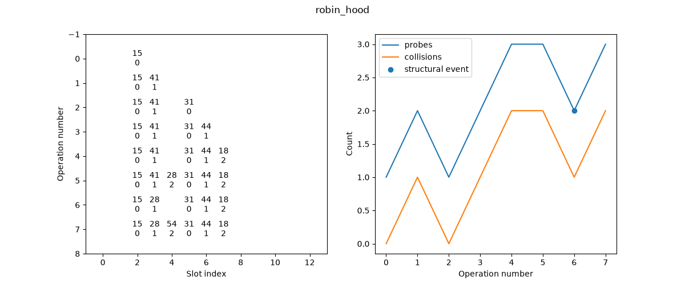

# Hash Table Strategies


Two open-addressing hash tables in pure Python, **Robin Hood hashing** and
**double hashing**, behind one interface, with built-in probe statistics to
compare them.

## Strategies

| | Robin Hood | Double hashing |
|---|---|---|
| Probe sequence | linear (`i + 1`) | key-dependent step: `1 + key % (capacity - 1)` |
| Insert | a key further from its home slot takes the place of a closer one, which keeps probe lengths even | first free slot, reusing the first tombstone found |
| Lookup miss | stops early once the current entry is closer to home than the key would be | stops at an empty slot |
| Delete | backward shift, no tombstones | slot is marked with a tombstone |
| Max load factor | 0.85 | 0.50 |

## Design

- `HashConfig` validates every assignment with descriptors.
- A metaclass checks the interface at class-definition time and registers each table for the `create_hash_table` factory. A dict would be enough here; the metaclass is a deliberate exercise.
- A class decorator counts probes, collisions and rehashes, so the algorithm code has no counters in it.

## Usage

Requires Python 3.15+ and [uv](https://docs.astral.sh/uv/).

```bash
uv sync
uv run pytest                      # tests
uv run python src/main.py          # console demo
uv run python src/visualisation.py # regenerates the chart below
```

## Robin Hood, step by step



Six colliding keys are inserted into a table of capacity 13, then one is
removed and another inserted. Left: slot contents as key / DIB (distance from
the home slot). Right: probes and collisions per operation.

At operation 6, key 41 is removed and key 28 shifts back from slot 4 to
slot 3: its DIB drops from 2 to 1 and no tombstone is left behind.

## Limitations

- Integer keys only, hashed as `key % capacity`.
- Not thread-safe.
- The comparison in `main.py` runs on one small workload; it is not a benchmark.
